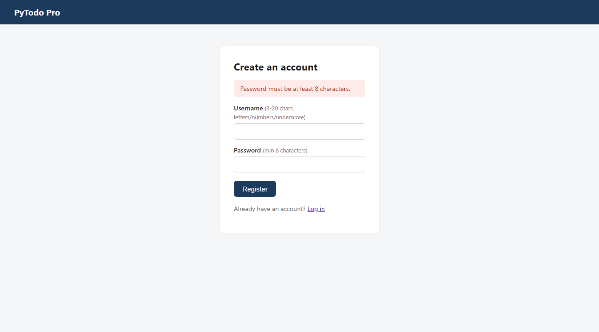
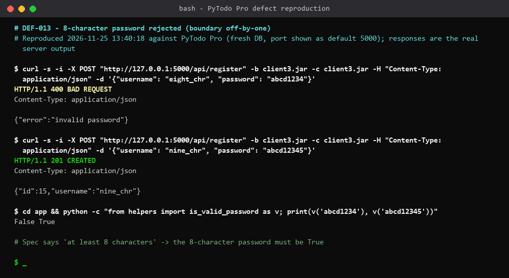
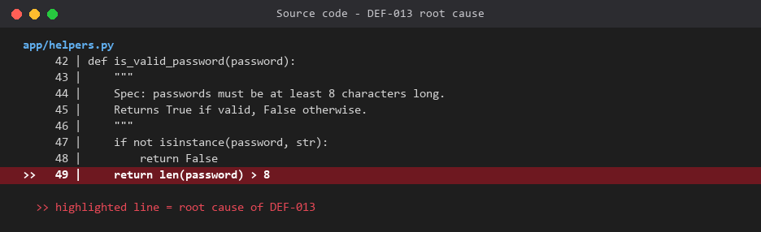

# DEF-013 - 8-character password rejected (boundary off-by-one)

| Field | Value |
|---|---|
| Severity | Moderate |
| Found by | Hanisah (BB, BUG-001), Fatin (WB/API, BUG-001) |
| Related test cases | TC-BB (BVA password), WB-001, API-015, AUTO-003 |
| Status | Open - **REPRODUCED** on 2026-11-25 13:40:18 |
| Environment | Python 3.14.7, Flask 3.0.3, SQLite (fresh temp DB), Windows 11, Chrome headless (Selenium) |
| Reproduced by | `07_Test_Management/Defect_Evidence/reproduce_defects.py` (def013) |

## Expected
An 8-character password is accepted (spec: at least 8).

## Actual (observed in this run)
8 characters -> HTTP 400 (rejected); 9 characters -> HTTP 201. Off-by-one in boundary (> instead of >=).

## Screenshots
**screenshot_8char_rejected.png** - Register page with an 8-character password: rejected with 'at least 8 characters' - contradicting its own message.



## Terminal evidence (PNG)
Requests replayed as the equivalent `curl` commands; every status code and body shown is the real response from this run.



## Root cause in source (PNG)



## Captured request / response trace (text)
```text
[1] >>> POST /api/register   json={'username': 'eight_chr', 'password': 'abcd1234'}
    <<< HTTP 400
        {"error":"invalid password"}
[2] >>> POST /api/register   json={'username': 'nine_chr', 'password': 'abcd12345'}
    <<< HTTP 201
        {"id":15,"username":"nine_chr"}
$ cd app && python -c "from helpers import is_valid_password as v; print(v('abcd1234'), v('abcd12345'))"
    False True
# Spec says 'at least 8 characters' -> the 8-character password must be True
```

## Root cause - faulty source lines (`>>` marks the defect)
```text
app/helpers.py
     42 | def is_valid_password(password):
     43 |     """
     44 |     Spec: passwords must be at least 8 characters long.
     45 |     Returns True if valid, False otherwise.
     46 |     """
     47 |     if not isinstance(password, str):
     48 |         return False
>>   49 |     return len(password) > 8
```

## Supporting evidence from other members
- [`02_White_Box_Coverage/evidence/WB-001_Unit_Test_Results.png`](../../../02_White_Box_Coverage/evidence/WB-001_Unit_Test_Results.png)
- [`04_Web_API/evidence/API-015_Password_Boundary_Failed.png`](../../../04_Web_API/evidence/API-015_Password_Boundary_Failed.png)
- [`06_Automation_Regression/evidence/AUTO-003_Password_Boundary_Failed.png`](../../../06_Automation_Regression/evidence/AUTO-003_Password_Boundary_Failed.png)
