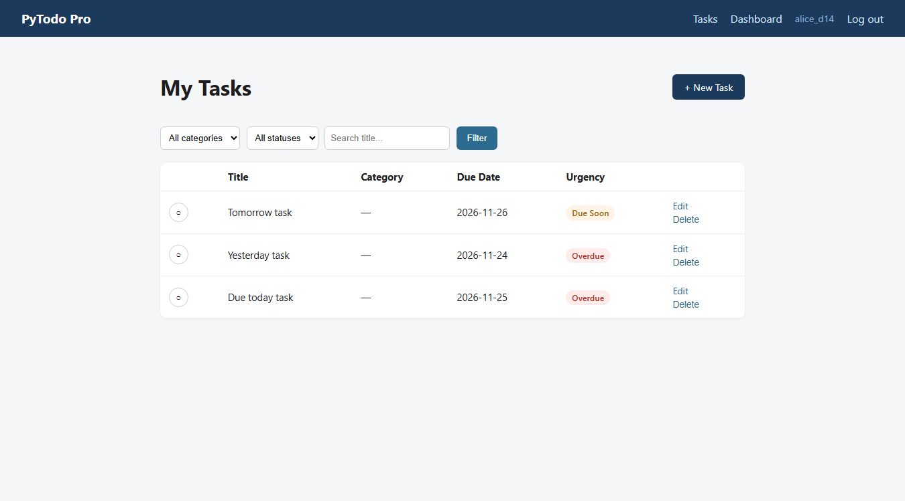

# DEF-014 - Task due today shown as Overdue

| Field | Value |
|---|---|
| Severity | Moderate |
| Found by | Hanisah (BB, BUG-002), Fatin (WB, BUG-002), Alia (TC-GUI-107) |
| Related test cases | TC-BB (urgency EP/BVA), WB-001, WB-005, TC-GUI-107 |
| Status | Open - **REPRODUCED** on 2026-11-25 13:09:04 |
| Environment | Python 3.14.7, Flask 3.0.3, SQLite (fresh temp DB), Windows 11, Chrome headless (Selenium) |
| Reproduced by | `07_Test_Management/Defect_Evidence/reproduce_defects.py` (def014) |

## Expected
Task due today labelled 'Due Today'.

## Actual (observed in this run)
Task due today (2026-11-25) returned urgency 'Overdue' instead of 'Due Today'; the 'Due Today' label can never appear.

## Screenshots
**screenshot_due_today_overdue.png** - Task list on 2026-11-25: 'Due today task' carries the Overdue badge, same as yesterday's task.



## Captured request / response trace
```text
# setup: registered 'alice_d14' -> HTTP 201
[1] >>> POST /api/tasks   json={'title': 'Due today task', 'due_date': '2026-11-25'}
    <<< HTTP 201
        {"category":null,"category_id":null,"completed_at":null,"created_at":"2026-11-25T13:09:27.041848","description":"","done":false,"due_date":"2026-11-25","id":15,"title":"Due today task","urgency":"Overdue"}
# helpers.compute_urgency('2026-11-25', today=2026-11-25) -> 'Overdue'  (spec: 'Due Today')
```

## Root cause - faulty source lines (`>>` marks the defect)
```text
app/helpers.py
     31 |     due = datetime.strptime(due_date_str, "%Y-%m-%d").date()
     32 | 
>>   33 |     if due <= today:
     34 |         return "Overdue"
     35 | 
     36 |     delta_days = (due - today).days
     37 |     if delta_days <= 2:
     38 |         return "Due Soon"
```

## Supporting evidence from other members
- [`02_White_Box_Coverage/evidence/WB-005_Urgency_Flowchart.png`](../../../02_White_Box_Coverage/evidence/WB-005_Urgency_Flowchart.png)
- [`02_White_Box_Coverage/evidence/WB-001_Unit_Test_Results.png`](../../../02_White_Box_Coverage/evidence/WB-001_Unit_Test_Results.png)
