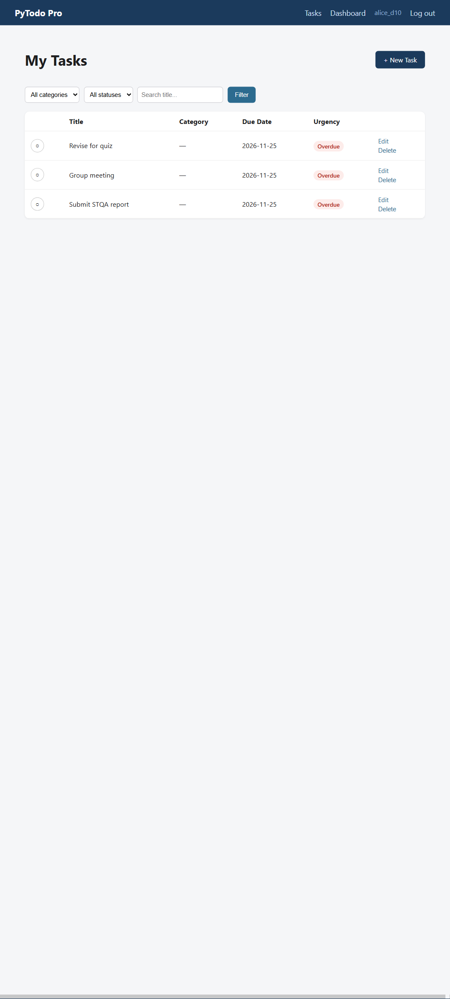

# DEF-010 - No viewport meta tag - mobile shows shrunken desktop layout

| Field | Value |
|---|---|
| Severity | Moderate |
| Found by | Alia (TC-GUI-114) |
| Related test cases | TC-GUI-114 (CFG-04) |
| Status | Open - **REPRODUCED** on 2026-11-25 13:09:04 |
| Environment | Python 3.14.7, Flask 3.0.3, SQLite (fresh temp DB), Windows 11, Chrome headless (Selenium) |
| Reproduced by | `07_Test_Management/Defect_Evidence/reproduce_defects.py` (def010) |

## Expected
Layout adapts to phone width; text readable without zoom.

## Actual (observed in this run)
No viewport meta tag; on a phone the page is laid out at 980px and shrunk.

## Screenshots
**screenshot_pixel7_task_list.png** - Chrome Pixel 7 emulation: page laid out at 980px for a 412px-wide screen, so everything is scaled down.



## Captured request / response trace
```text
# setup: registered 'alice_d10' -> HTTP 201
[1] >>> GET /
    <<< HTTP 200
# <meta name="viewport"> present in rendered page: False
# Pixel 7 emulation: screen.width=412px, layout viewport=980px
```

## Root cause - faulty source lines (`>>` marks the defect)
```text
app/templates/base.html
      1 | <!doctype html>
      2 | <html lang="en">
>>    3 | <head>
>>    4 |     <meta charset="utf-8">
>>    5 |     <title>PyTodo Pro</title>
>>    6 |     <link rel="stylesheet" href="{{ url_for('static', filename='style.css') }}">
      7 | </head>
```

## Supporting evidence from other members
- [`03_Special_Testing/GUI_Compatibility/screenshots/CFG-04_05_task_list.png`](../../../../03_Special_Testing/GUI_Compatibility/screenshots/CFG-04_05_task_list.png)
