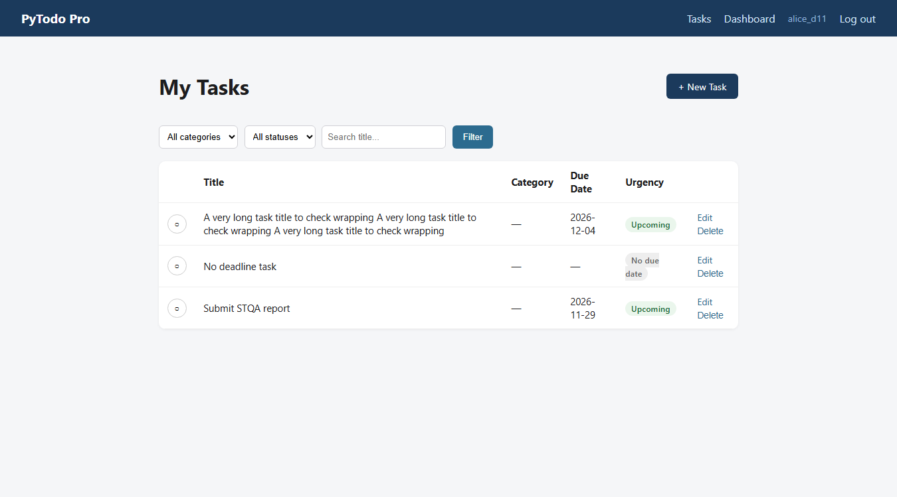

# DEF-011 - Task table cells wrap at 1366 px

| Field | Value |
|---|---|
| Severity | Minor |
| Found by | Alia (TC-GUI-106) |
| Related test cases | TC-GUI-106 (CFG-01) |
| Status | Open - **REPRODUCED** on 2026-11-25 13:09:04 |
| Environment | Python 3.14.7, Flask 3.0.3, SQLite (fresh temp DB), Windows 11, Chrome headless (Selenium) |
| Reproduced by | `07_Test_Management/Defect_Evidence/reproduce_defects.py` (def011) |

## Expected
Due dates and badges stay on one line.

## Actual (observed in this run)
At 1366px the due-date column is too narrow: dates break as '2026-' / '11-29' and the badge splits.

## Screenshots
**screenshot_1366_task_list.png** - Task list at 1366x900: due dates and the 'No due date' badge wrap onto two lines.



## Captured request / response trace
```text
# setup: registered 'alice_d11' -> HTTP 201
# Seeded tasks with and without due dates; opened task list at 1366x900
# text '2026-12-04': rendered on 2 line(s) in a 83px-wide box
# text 'No due date': rendered on 2 line(s) in a 51px-wide box
# text '2026-11-29': rendered on 2 line(s) in a 83px-wide box
```

## Root cause - faulty source lines (`>>` marks the defect)
```text
app/templates/index.html
     42 |                 </form>
     43 |             </td>
     44 |             <td class="title-cell">{{ t.title|safe }}</td>
     45 |             <td>{{ t.category or '—' }}</td>
     46 |             <td>{{ t.due_date or '—' }}</td>
     47 |             <td><span class="badge badge-{{ t.urgency|lower|replace(' ', '-') }}">{{ t.urgency }}</span></td>
     48 |             <td class="actions">
     49 |                 <a href="{{ url_for('edit_task', task_id=t.id) }}">Edit</a>
     50 |                 <form method="post" action="{{ url_for('delete_task_web', task_id=t.id) }}" onsubmit="return confirm('Delete this task?');">
```

## Supporting evidence from other members
- [`03_Special_Testing/GUI_Compatibility/screenshots/CFG-01_05_task_list.png`](../../../../03_Special_Testing/GUI_Compatibility/screenshots/CFG-01_05_task_list.png)
