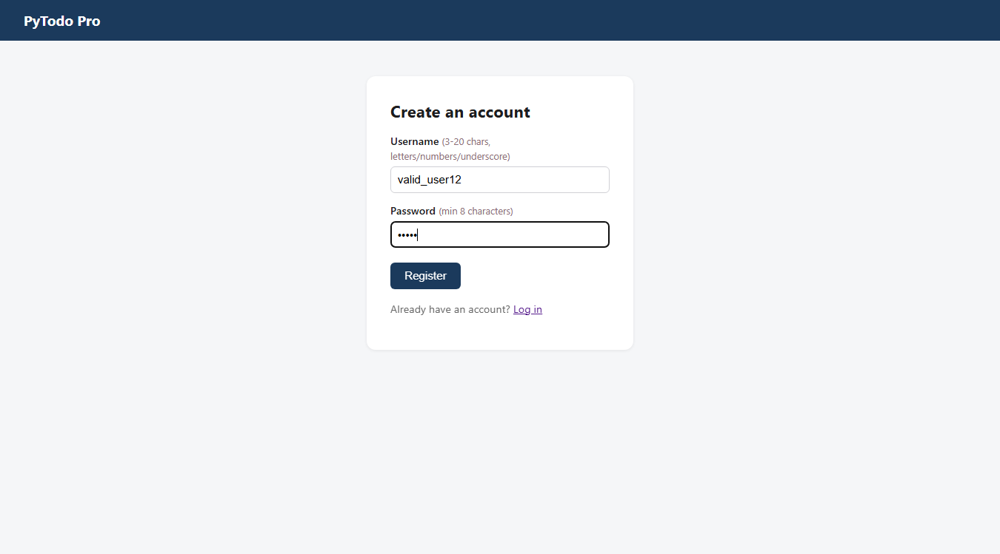
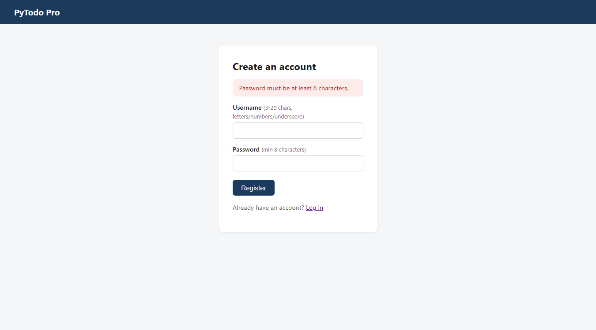
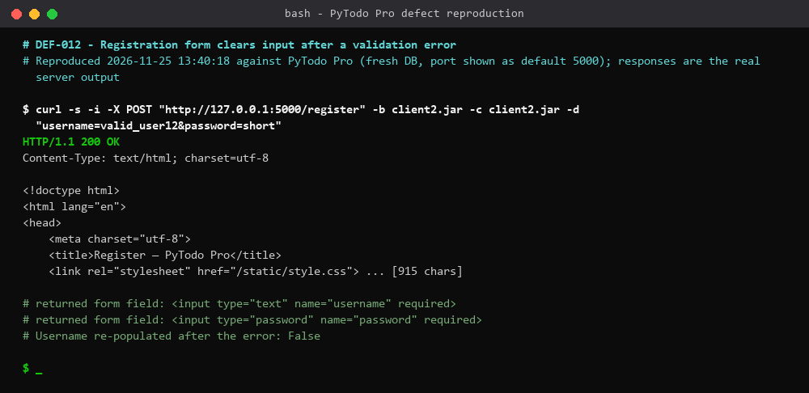
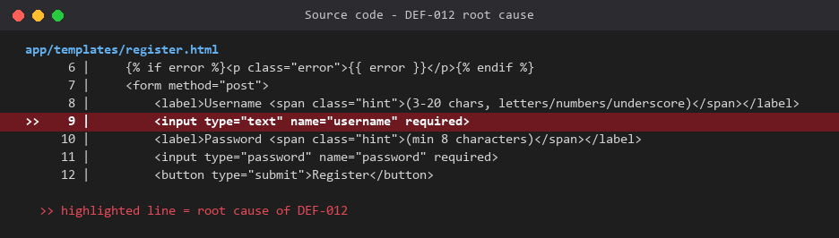

# DEF-012 - Registration form clears input after a validation error

| Field | Value |
|---|---|
| Severity | Minor |
| Found by | Alia (TC-GUI-104) |
| Related test cases | TC-GUI-104 |
| Status | Open - **REPRODUCED** on 2026-11-25 13:40:18 |
| Environment | Python 3.14.7, Flask 3.0.3, SQLite (fresh temp DB), Windows 11, Chrome headless (Selenium) |
| Reproduced by | `07_Test_Management/Defect_Evidence/reproduce_defects.py` (def012) |

## Expected
Username stays filled in after an error; only the password is cleared.

## Actual (observed in this run)
Validation error is shown but the username field comes back empty (inputs have no value attribute).

## Screenshots
**screenshot_1_before_submit.png** - Before submit: valid username, too-short password.



**screenshot_2_after_error.png** - After the error: both fields are empty - the user must retype the valid username.



## Terminal evidence (PNG)
Requests replayed as the equivalent `curl` commands; every status code and body shown is the real response from this run.



## Root cause in source (PNG)



## Captured request / response trace (text)
```text
[1] >>> POST /register   form={'username': 'valid_user12', 'password': 'short'}
    <<< HTTP 200
# returned form field: <input type="text" name="username" required>
# returned form field: <input type="password" name="password" required>
# Username re-populated after the error: False
```

## Root cause - faulty source lines (`>>` marks the defect)
```text
app/templates/register.html
      6 |     <p class="error">{{ error }}</p>
      7 |     <form method="post">
      8 |         <label>Username <span class="hint">(3-20 chars, letters/numbers/underscore)</span></label>
>>    9 |         <input type="text" name="username" required>
     10 |         <label>Password <span class="hint">(min 8 characters)</span></label>
     11 |         <input type="password" name="password" required>
     12 |         <button type="submit">Register</button>
```

## Supporting evidence from other members
- [`03_Special_Testing/GUI_Compatibility/screenshots/CFG-01_04_register_error.png`](../../../../03_Special_Testing/GUI_Compatibility/screenshots/CFG-01_04_register_error.png)
