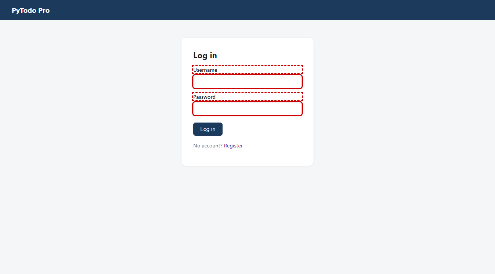

# DEF-017 - Form labels not programmatically linked to inputs

| Field | Value |
|---|---|
| Severity | Minor |
| Found by | Hanisah (TC-ACC-005) |
| Related test cases | TC-ACC-005 |
| Status | Open - **REPRODUCED** on 2026-11-25 13:09:04 |
| Environment | Python 3.14.7, Flask 3.0.3, SQLite (fresh temp DB), Windows 11, Chrome headless (Selenium) |
| Reproduced by | `07_Test_Management/Defect_Evidence/reproduce_defects.py` (def017) |

## Expected
Every input has an associated <label for=id> (WCAG 1.3.1, 4.1.2).

## Actual (observed in this run)
No <label> has a for= attribute and no input has an id, so input.labels is empty for every field (WCAG 1.3.1 / 4.1.2).

## Screenshots
**screenshot_unlinked_labels.png** - Login form: labels (dashed) and inputs (solid) outlined in red have no programmatic link - screen readers announce the fields without a name.



## Captured request / response trace
```text
[1] >>> GET /login
    <<< HTTP 200
# /login: 2 <label> (0 with for=), 2 <input> (0 with id=)
#    <label>
#    <label>
[2] >>> GET /register
    <<< HTTP 200
# /register: 2 <label> (0 with for=), 2 <input> (0 with id=)
#    <label>
#    <label>
[3] >>> GET /tasks/new
    <<< HTTP 200
# /tasks/new: 4 <label>, 0 with for=
# browser: input name='username' -> associated labels (input.labels.length) = 0
# browser: input name='password' -> associated labels (input.labels.length) = 0
```

## Root cause - faulty source lines (`>>` marks the defect)
```text
app/templates/login.html
      7 |     <form method="post">
>>    8 |         <label>Username</label>
>>    9 |         <input type="text" name="username" required>
>>   10 |         <label>Password</label>
>>   11 |         <input type="password" name="password" required>
     12 |         <button type="submit">Log in</button>
```
