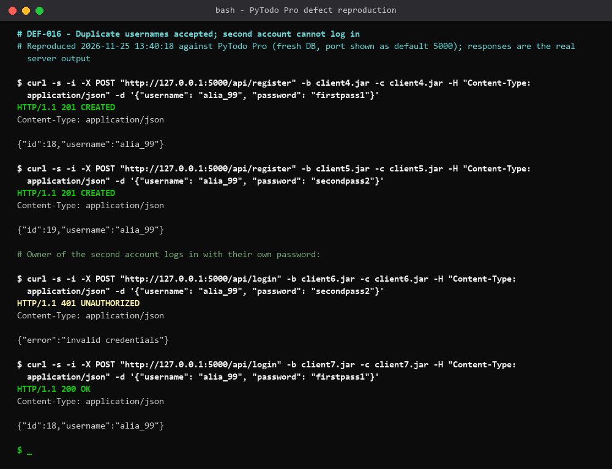
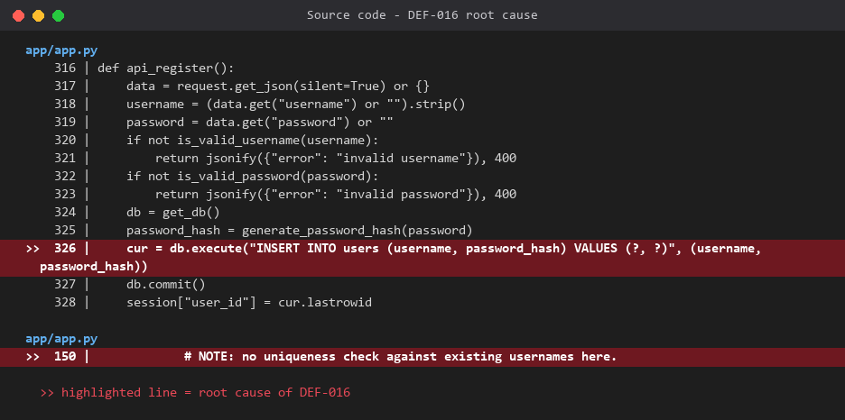

# DEF-016 - Duplicate usernames accepted; second account cannot log in

| Field | Value |
|---|---|
| Severity | Moderate |
| Found by | Fatin (API, BUG-004), Alia (TC-SEC-004) |
| Related test cases | API-016, AUTO-004, TC-SEC-004 |
| Status | Open - **REPRODUCED** on 2026-11-25 13:40:18 |
| Environment | Python 3.14.7, Flask 3.0.3, SQLite (fresh temp DB), Windows 11 |
| Reproduced by | `07_Test_Management/Defect_Evidence/reproduce_defects.py` (def016) |

## Expected
Second registration rejected (409 / 'username taken').

## Actual (observed in this run)
Same username registered twice (HTTP 201, 201, two different ids); second owner cannot log in (HTTP 401).

## Terminal evidence (PNG)
Requests replayed as the equivalent `curl` commands; every status code and body shown is the real response from this run.



## Root cause in source (PNG)



## Captured request / response trace (text)
```text
[1] >>> POST /api/register   json={'username': 'alia_99', 'password': 'firstpass1'}
    <<< HTTP 201
        {"id":18,"username":"alia_99"}
[2] >>> POST /api/register   json={'username': 'alia_99', 'password': 'secondpass2'}
    <<< HTTP 201
        {"id":19,"username":"alia_99"}
# Owner of the second account logs in with their own password:
[3] >>> POST /api/login   json={'username': 'alia_99', 'password': 'secondpass2'}
    <<< HTTP 401
        {"error":"invalid credentials"}
[4] >>> POST /api/login   json={'username': 'alia_99', 'password': 'firstpass1'}
    <<< HTTP 200
        {"id":18,"username":"alia_99"}
```

## Root cause - faulty source lines (`>>` marks the defect)
```text
app/app.py
    316 | def api_register():
    317 |     data = request.get_json(silent=True) or {}
    318 |     username = (data.get("username") or "").strip()
    319 |     password = data.get("password") or ""
    320 |     if not is_valid_username(username):
    321 |         return jsonify({"error": "invalid username"}), 400
    322 |     if not is_valid_password(password):
    323 |         return jsonify({"error": "invalid password"}), 400
    324 |     db = get_db()
    325 |     password_hash = generate_password_hash(password)
>>  326 |     cur = db.execute("INSERT INTO users (username, password_hash) VALUES (?, ?)", (username, password_hash))
    327 |     db.commit()
    328 |     session["user_id"] = cur.lastrowid

app/app.py
>>  150 |             # NOTE: no uniqueness check against existing usernames here.
```

## Supporting evidence from other members
- [`04_Web_API/evidence/API-016_Duplicate_Username_Failed.png`](../../../04_Web_API/evidence/API-016_Duplicate_Username_Failed.png)
- [`06_Automation_Regression/evidence/AUTO-004_Duplicate_Username_Failed.png`](../../../06_Automation_Regression/evidence/AUTO-004_Duplicate_Username_Failed.png)
