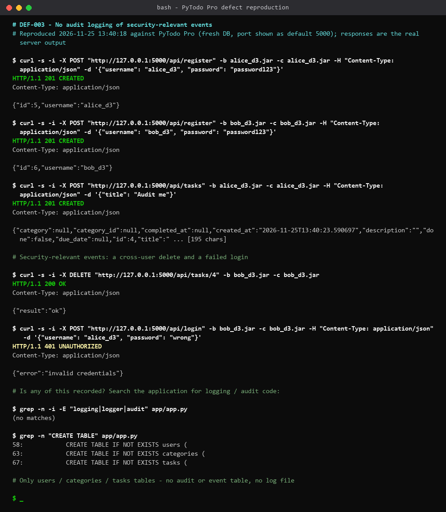
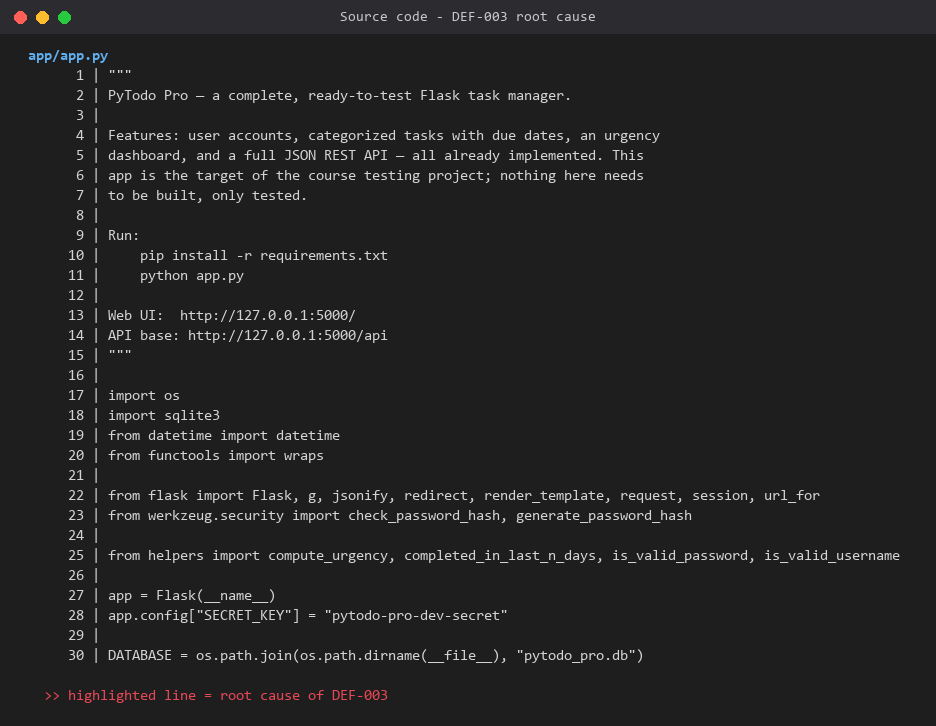

# DEF-003 - No audit logging of security-relevant events

| Field | Value |
|---|---|
| Severity | Moderate |
| Found by | Intan (DEF-003, STRIDE Repudiation) |
| Related test cases | STRIDE-R |
| Status | Open - **REPRODUCED** on 2026-11-25 13:40:18 |
| Environment | Python 3.14.7, Flask 3.0.3, SQLite (fresh temp DB), Windows 11 |
| Reproduced by | `07_Test_Management/Defect_Evidence/reproduce_defects.py` (def003) |

## Expected
Logins, failed logins and deletions are recorded with user, time and target.

## Actual (observed in this run)
No log entry, audit table or logger exists - the cross-user delete and failed login leave no record (repudiation threat).

## Terminal evidence (PNG)
Requests replayed as the equivalent `curl` commands; every status code and body shown is the real response from this run.



## Root cause in source (PNG)



## Captured request / response trace (text)
```text
[1] >>> POST /api/register   json={'username': 'alice_d3', 'password': 'password123'}
    <<< HTTP 201
        {"id":5,"username":"alice_d3"}
[2] >>> POST /api/register   json={'username': 'bob_d3', 'password': 'password123'}
    <<< HTTP 201
        {"id":6,"username":"bob_d3"}
[3] >>> POST /api/tasks   json={'title': 'Audit me'}
    <<< HTTP 201
# Security-relevant events: a cross-user delete and a failed login
[4] >>> DELETE /api/tasks/4
    <<< HTTP 200
        {"result":"ok"}
[5] >>> POST /api/login   json={'username': 'alice_d3', 'password': 'wrong'}
    <<< HTTP 401
        {"error":"invalid credentials"}
# Is any of this recorded? Search the application for logging / audit code:
$ grep -n -i -E "logging|logger|audit" app/app.py
    (no matches)
$ grep -n "CREATE TABLE" app/app.py
    58:            CREATE TABLE IF NOT EXISTS users (
    63:            CREATE TABLE IF NOT EXISTS categories (
    67:            CREATE TABLE IF NOT EXISTS tasks (
# Only users / categories / tasks tables - no audit or event table, no log file
```

## Root cause - faulty source lines (`>>` marks the defect)
```text
app/app.py
      1 | """
      2 | PyTodo Pro — a complete, ready-to-test Flask task manager.
      3 | 
      4 | Features: user accounts, categorized tasks with due dates, an urgency
      5 | dashboard, and a full JSON REST API — all already implemented. This
      6 | app is the target of the course testing project; nothing here needs
      7 | to be built, only tested.
      8 | 
      9 | Run:
     10 |     pip install -r requirements.txt
     11 |     python app.py
     12 | 
     13 | Web UI:  http://127.0.0.1:5000/
     14 | API base: http://127.0.0.1:5000/api
     15 | """
     16 | 
     17 | import os
     18 | import sqlite3
     19 | from datetime import datetime
     20 | from functools import wraps
     21 | 
     22 | from flask import Flask, g, jsonify, redirect, render_template, request, session, url_for
     23 | from werkzeug.security import check_password_hash, generate_password_hash
     24 | 
     25 | from helpers import compute_urgency, completed_in_last_n_days, is_valid_password, is_valid_username
     26 | 
     27 | app = Flask(__name__)
     28 | app.config["SECRET_KEY"] = "pytodo-pro-dev-secret"
     29 | 
     30 | DATABASE = os.path.join(os.path.dirname(__file__), "pytodo_pro.db")
```

## Supporting evidence from other members
- [`05_Security_Performance/STRIDE/README.md`](../../../../05_Security_Performance/STRIDE/README.md)
