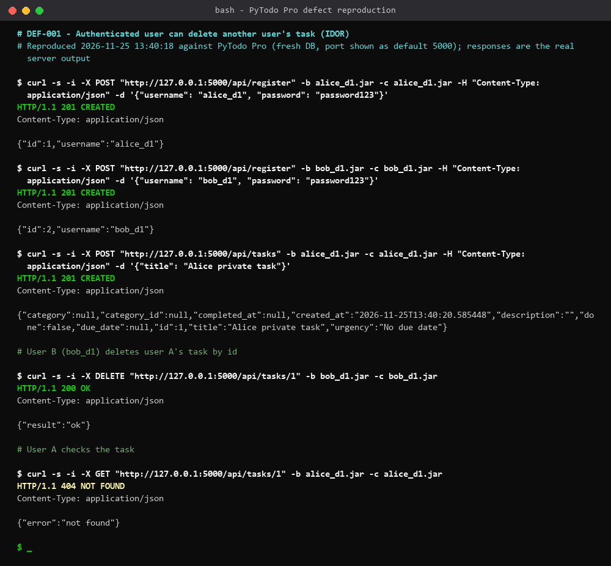
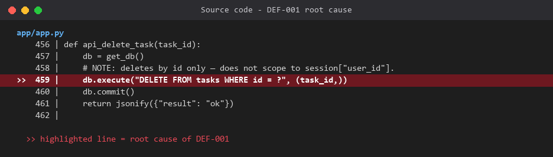

# DEF-001 - Authenticated user can delete another user's task (IDOR)

| Field | Value |
|---|---|
| Severity | Critical |
| Found by | Fatin (BUG-005), Intan (DEF-001), Alia (TC-SEC-005) |
| Related test cases | TC-SEC-005, API-021/022, AUTO-002 |
| Status | Open - **REPRODUCED** on 2026-11-25 13:40:18 |
| Environment | Python 3.14.7, Flask 3.0.3, SQLite (fresh temp DB), Windows 11 |
| Reproduced by | `07_Test_Management/Defect_Evidence/reproduce_defects.py` (def001) |

## Expected
User B gets 404; user A's task is untouched.

## Actual (observed in this run)
B's DELETE returned HTTP 200; A's GET then returned HTTP 404 - task destroyed by another user.

## Terminal evidence (PNG)
Requests replayed as the equivalent `curl` commands; every status code and body shown is the real response from this run.



## Root cause in source (PNG)



## Captured request / response trace (text)
```text
[1] >>> POST /api/register   json={'username': 'alice_d1', 'password': 'password123'}
    <<< HTTP 201
        {"id":1,"username":"alice_d1"}
[2] >>> POST /api/register   json={'username': 'bob_d1', 'password': 'password123'}
    <<< HTTP 201
        {"id":2,"username":"bob_d1"}
[3] >>> POST /api/tasks   json={'title': 'Alice private task'}
    <<< HTTP 201
        {"category":null,"category_id":null,"completed_at":null,"created_at":"2026-11-25T13:40:20.585448","description":"","done":false,"due_date":null,"id":1,"title":"Alice private task","urgency":"No due date"}
# User B (bob_d1) deletes user A's task by id
[4] >>> DELETE /api/tasks/1
    <<< HTTP 200
        {"result":"ok"}
# User A checks the task
[5] >>> GET /api/tasks/1
    <<< HTTP 404
        {"error":"not found"}
```

## Root cause - faulty source lines (`>>` marks the defect)
```text
app/app.py
    456 | def api_delete_task(task_id):
    457 |     db = get_db()
    458 |     # NOTE: deletes by id only — does not scope to session["user_id"].
>>  459 |     db.execute("DELETE FROM tasks WHERE id = ?", (task_id,))
    460 |     db.commit()
    461 |     return jsonify({"result": "ok"})
    462 | 
```

## Supporting evidence from other members
- [`04_Web_API/evidence/API-021_Unauthorized_Deletion_Failed.png`](../../../../04_Web_API/evidence/API-021_Unauthorized_Deletion_Failed.png)
- [`04_Web_API/evidence/API-022_Unauthorized_Deletion_Confirmed.png`](../../../../04_Web_API/evidence/API-022_Unauthorized_Deletion_Confirmed.png)
- [`06_Automation_Regression/evidence/AUTO-002_Unauthorized_Deletion_Failed.png`](../../../../06_Automation_Regression/evidence/AUTO-002_Unauthorized_Deletion_Failed.png)
