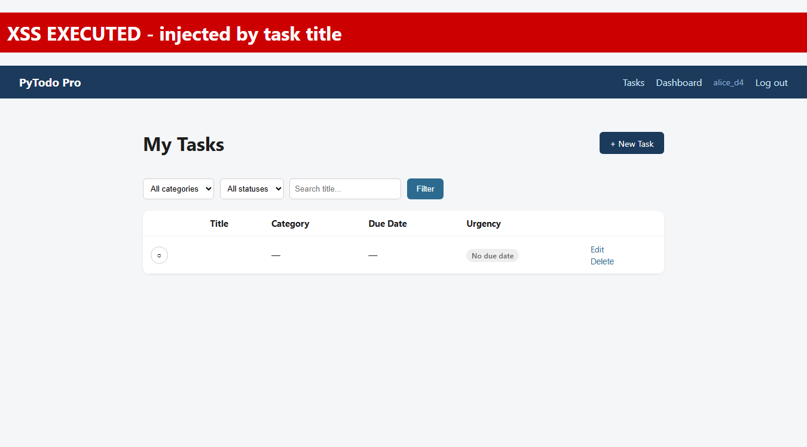
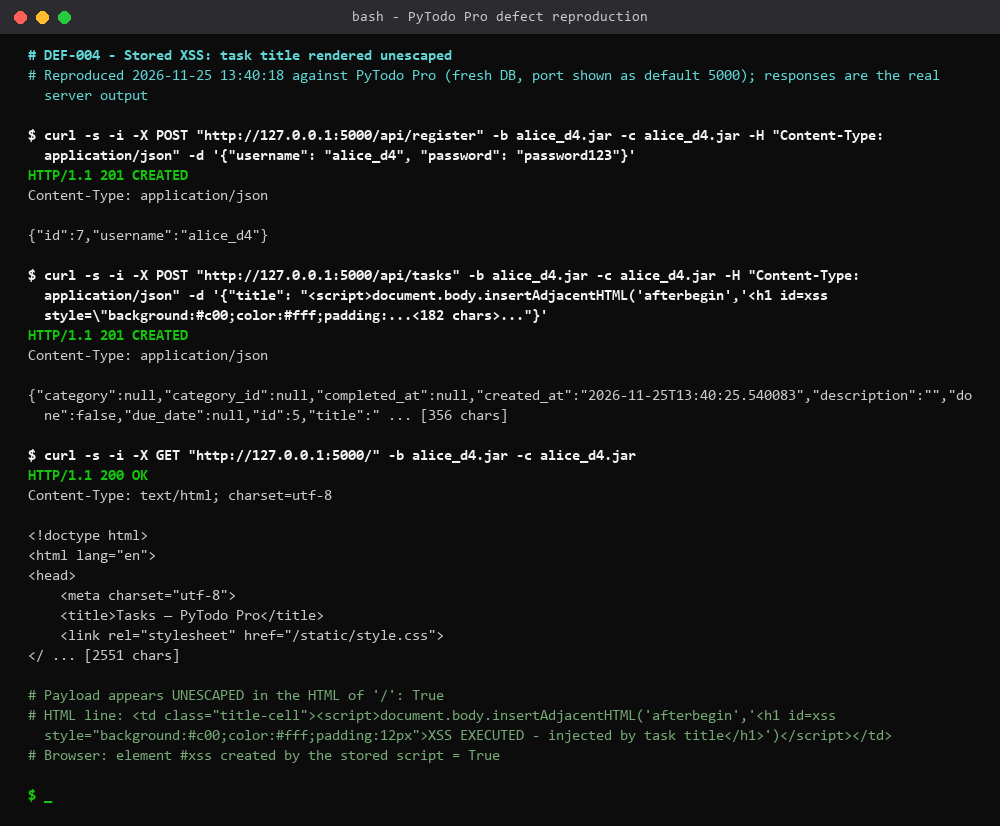
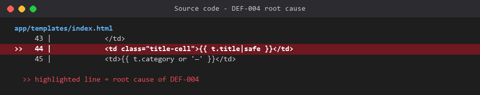

# DEF-004 - Stored XSS: task title rendered unescaped

| Field | Value |
|---|---|
| Severity | Critical |
| Found by | Alia (TC-SEC-009) |
| Related test cases | TC-SEC-009 |
| Status | Open - **REPRODUCED** on 2026-11-25 13:40:18 |
| Environment | Python 3.14.7, Flask 3.0.3, SQLite (fresh temp DB), Windows 11, Chrome headless (Selenium) |
| Reproduced by | `07_Test_Management/Defect_Evidence/reproduce_defects.py` (def004) |

## Expected
Title shown as plain text (HTML-escaped).

## Actual (observed in this run)
The title is rendered with |safe, so the stored <script> runs for every visit to the task list.

## Screenshots
**screenshot_xss_executed.png** - Task list after login: the red banner was created by JavaScript stored in a task title.



## Terminal evidence (PNG)
Requests replayed as the equivalent `curl` commands; every status code and body shown is the real response from this run.



## Root cause in source (PNG)



## Captured request / response trace (text)
```text
[1] >>> POST /api/register   json={'username': 'alice_d4', 'password': 'password123'}
    <<< HTTP 201
        {"id":7,"username":"alice_d4"}
[2] >>> POST /api/tasks   json={'title': '<script>document.body.insertAdjacentHTML(\'afterbegin\',\'<h1 id=xss style="background:#c00;color:#fff;padding:12px">XSS EXECUTED - injected by task title</h1>\')</script>'}
    <<< HTTP 201
[3] >>> GET /
    <<< HTTP 200
# Payload appears UNESCAPED in the HTML of '/': True
# HTML line: <td class="title-cell"><script>document.body.insertAdjacentHTML('afterbegin','<h1 id=xss style="background:#c00;color:#fff;padding:12px">XSS EXECUTED - injected by task title</h1>')</script></td>
# Browser: element #xss created by the stored script = True
```

## Root cause - faulty source lines (`>>` marks the defect)
```text
app/templates/index.html
     43 |             </td>
>>   44 |             <td class="title-cell">{{ t.title|safe }}</td>
     45 |             <td>{{ t.category or '—' }}</td>
```
