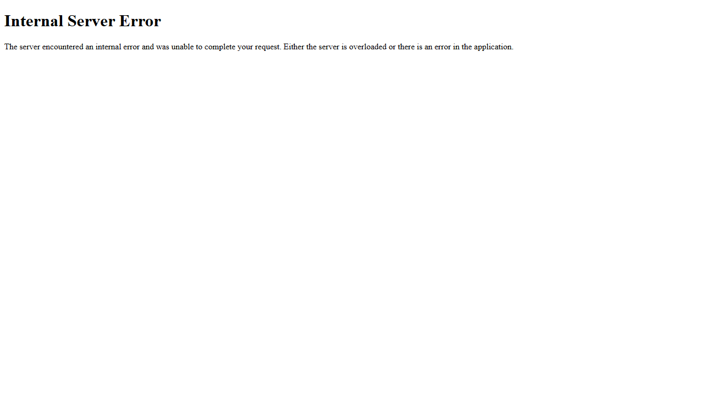
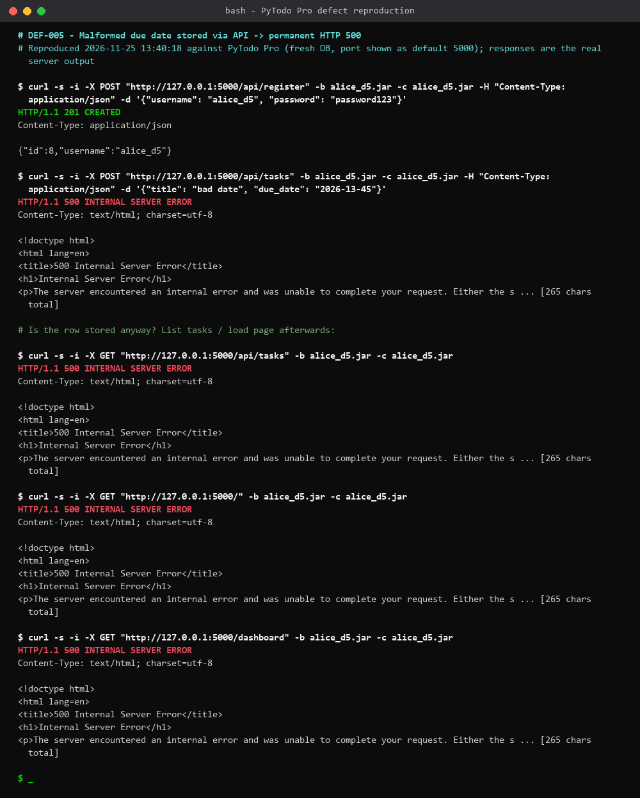
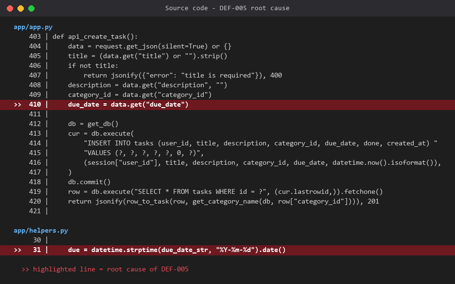

# DEF-005 - Malformed due date stored via API -> permanent HTTP 500

| Field | Value |
|---|---|
| Severity | Critical |
| Found by | Alia (TC-SEC-014) |
| Related test cases | TC-SEC-014 |
| Status | Open - **REPRODUCED** on 2026-11-25 13:40:18 |
| Environment | Python 3.14.7, Flask 3.0.3, SQLite (fresh temp DB), Windows 11, Chrome headless (Selenium) |
| Reproduced by | `07_Test_Management/Defect_Evidence/reproduce_defects.py` (def005) |

## Expected
HTTP 400 with a validation message; nothing stored.

## Actual (observed in this run)
Create returned 500 but the row was stored; afterwards /api/tasks=500, /=500, /dashboard=500 - the account is permanently broken.

## Screenshots
**screenshot_task_list_500.png** - The user's task list after the bad request: Internal Server Error on every visit.



## Terminal evidence (PNG)
Requests replayed as the equivalent `curl` commands; every status code and body shown is the real response from this run.



## Root cause in source (PNG)



## Captured request / response trace (text)
```text
[1] >>> POST /api/register   json={'username': 'alice_d5', 'password': 'password123'}
    <<< HTTP 201
        {"id":8,"username":"alice_d5"}
[2] >>> POST /api/tasks   json={'title': 'bad date', 'due_date': '2026-13-45'}
    <<< HTTP 500
        <!doctype html>
        <html lang=en>
        <title>500 Internal Server Error</title>
        <h1>Internal Server Error</h1>
        <p>The server encountered an internal error and was unable to complete your request. Either the s ... [265 chars total]
# Is the row stored anyway? List tasks / load page afterwards:
[3] >>> GET /api/tasks
    <<< HTTP 500
        <!doctype html>
        <html lang=en>
        <title>500 Internal Server Error</title>
        <h1>Internal Server Error</h1>
        <p>The server encountered an internal error and was unable to complete your request. Either the s ... [265 chars total]
[4] >>> GET /
    <<< HTTP 500
        <!doctype html>
        <html lang=en>
        <title>500 Internal Server Error</title>
        <h1>Internal Server Error</h1>
        <p>The server encountered an internal error and was unable to complete your request. Either the s ... [265 chars total]
[5] >>> GET /dashboard
    <<< HTTP 500
        <!doctype html>
        <html lang=en>
        <title>500 Internal Server Error</title>
        <h1>Internal Server Error</h1>
        <p>The server encountered an internal error and was unable to complete your request. Either the s ... [265 chars total]
```

## Root cause - faulty source lines (`>>` marks the defect)
```text
app/app.py
    403 | def api_create_task():
    404 |     data = request.get_json(silent=True) or {}
    405 |     title = (data.get("title") or "").strip()
    406 |     if not title:
    407 |         return jsonify({"error": "title is required"}), 400
    408 |     description = data.get("description", "")
    409 |     category_id = data.get("category_id")
>>  410 |     due_date = data.get("due_date")
    411 | 
    412 |     db = get_db()
    413 |     cur = db.execute(
    414 |         "INSERT INTO tasks (user_id, title, description, category_id, due_date, done, created_at) "
    415 |         "VALUES (?, ?, ?, ?, ?, 0, ?)",
    416 |         (session["user_id"], title, description, category_id, due_date, datetime.now().isoformat()),
    417 |     )
    418 |     db.commit()
    419 |     row = db.execute("SELECT * FROM tasks WHERE id = ?", (cur.lastrowid,)).fetchone()
    420 |     return jsonify(row_to_task(row, get_category_name(db, row["category_id"]))), 201
    421 | 

app/helpers.py
     30 | 
>>   31 |     due = datetime.strptime(due_date_str, "%Y-%m-%d").date()
```
