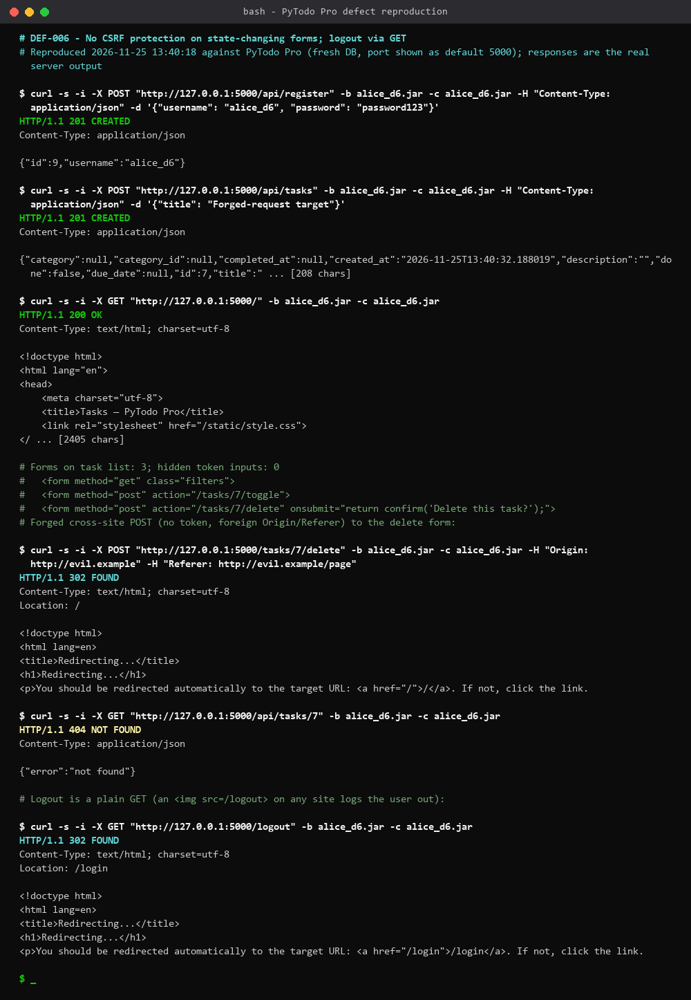
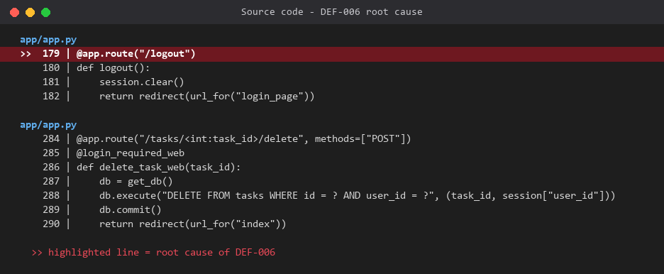

# DEF-006 - No CSRF protection on state-changing forms; logout via GET

| Field | Value |
|---|---|
| Severity | Major |
| Found by | Alia (TC-SEC-010) |
| Related test cases | TC-SEC-010 |
| Status | Open - **REPRODUCED** on 2026-11-25 13:40:18 |
| Environment | Python 3.14.7, Flask 3.0.3, SQLite (fresh temp DB), Windows 11 |
| Reproduced by | `07_Test_Management/Defect_Evidence/reproduce_defects.py` (def006) |

## Expected
Forms carry an anti-CSRF token; cross-origin POST rejected; logout is POST.

## Actual (observed in this run)
Forged POST with foreign Origin accepted (HTTP 302), task deleted (GET -> 404); GET /logout -> 302.

## Terminal evidence (PNG)
Requests replayed as the equivalent `curl` commands; every status code and body shown is the real response from this run.



## Root cause in source (PNG)



## Captured request / response trace (text)
```text
[1] >>> POST /api/register   json={'username': 'alice_d6', 'password': 'password123'}
    <<< HTTP 201
        {"id":9,"username":"alice_d6"}
[2] >>> POST /api/tasks   json={'title': 'Forged-request target'}
    <<< HTTP 201
[3] >>> GET /
    <<< HTTP 200
# Forms on task list: 3; hidden token inputs: 0
#   <form method="get" class="filters">
#   <form method="post" action="/tasks/7/toggle">
#   <form method="post" action="/tasks/7/delete" onsubmit="return confirm('Delete this task?');">
# Forged cross-site POST (no token, foreign Origin/Referer) to the delete form:
[4] >>> POST /tasks/7/delete
    <<< HTTP 302  Location: /
        <!doctype html>
        <html lang=en>
        <title>Redirecting...</title>
        <h1>Redirecting...</h1>
        <p>You should be redirected automatically to the target URL: <a href="/">/</a>. If not, click the link.
[5] >>> GET /api/tasks/7
    <<< HTTP 404
        {"error":"not found"}
# Logout is a plain GET (an  on any site logs the user out):
[6] >>> GET /logout
    <<< HTTP 302  Location: /login
        <!doctype html>
        <html lang=en>
        <title>Redirecting...</title>
        <h1>Redirecting...</h1>
        <p>You should be redirected automatically to the target URL: <a href="/login">/login</a>. If not, click the link.
```

## Root cause - faulty source lines (`>>` marks the defect)
```text
app/app.py
>>  179 | @app.route("/logout")
    180 | def logout():
    181 |     session.clear()
    182 |     return redirect(url_for("login_page"))

app/app.py
    284 | @app.route("/tasks/<int:task_id>/delete", methods=["POST"])
    285 | @login_required_web
    286 | def delete_task_web(task_id):
    287 |     db = get_db()
    288 |     db.execute("DELETE FROM tasks WHERE id = ? AND user_id = ?", (task_id, session["user_id"]))
    289 |     db.commit()
    290 |     return redirect(url_for("index"))
```
