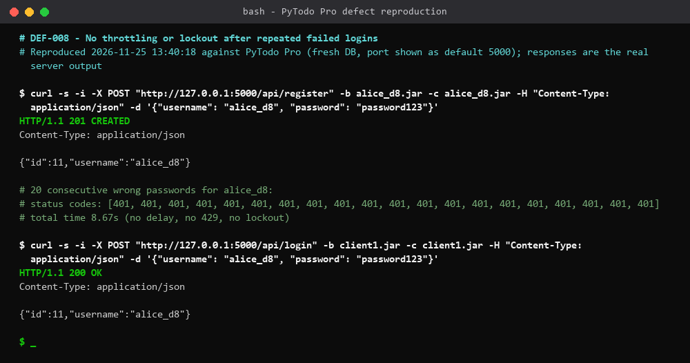
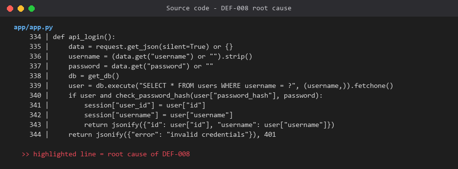

# DEF-008 - No throttling or lockout after repeated failed logins

| Field | Value |
|---|---|
| Severity | Moderate |
| Found by | Alia (TC-SEC-002) |
| Related test cases | TC-SEC-002 |
| Status | Open - **REPRODUCED** on 2026-11-25 13:40:18 |
| Environment | Python 3.14.7, Flask 3.0.3, SQLite (fresh temp DB), Windows 11 |
| Reproduced by | `07_Test_Management/Defect_Evidence/reproduce_defects.py` (def008) |

## Expected
HTTP 429 / temporary lockout after N failed attempts.

## Actual (observed in this run)
All 20 attempts answered 401 in 8.67s; the 21st (correct) attempt still logs in (HTTP 200) - unlimited guessing.

## Terminal evidence (PNG)
Requests replayed as the equivalent `curl` commands; every status code and body shown is the real response from this run.



## Root cause in source (PNG)



## Captured request / response trace (text)
```text
[1] >>> POST /api/register   json={'username': 'alice_d8', 'password': 'password123'}
    <<< HTTP 201
        {"id":11,"username":"alice_d8"}
# 20 consecutive wrong passwords for alice_d8:
# status codes: [401, 401, 401, 401, 401, 401, 401, 401, 401, 401, 401, 401, 401, 401, 401, 401, 401, 401, 401, 401]
# total time 8.67s (no delay, no 429, no lockout)
[2] >>> POST /api/login   json={'username': 'alice_d8', 'password': 'password123'}
    <<< HTTP 200
        {"id":11,"username":"alice_d8"}
```

## Root cause - faulty source lines (`>>` marks the defect)
```text
app/app.py
    334 | def api_login():
    335 |     data = request.get_json(silent=True) or {}
    336 |     username = (data.get("username") or "").strip()
    337 |     password = data.get("password") or ""
    338 |     db = get_db()
    339 |     user = db.execute("SELECT * FROM users WHERE username = ?", (username,)).fetchone()
    340 |     if user and check_password_hash(user["password_hash"], password):
    341 |         session["user_id"] = user["id"]
    342 |         session["username"] = user["username"]
    343 |         return jsonify({"id": user["id"], "username": user["username"]})
    344 |     return jsonify({"error": "invalid credentials"}), 401
```
