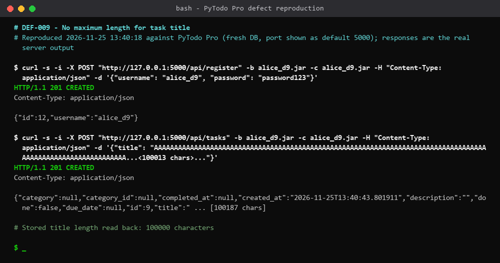
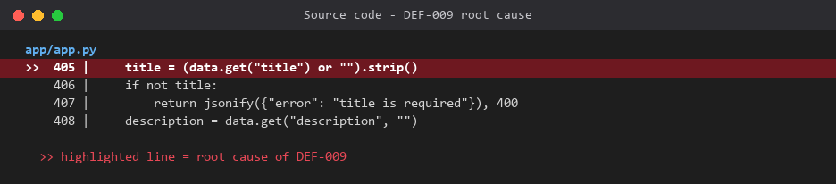

# DEF-009 - No maximum length for task title

| Field | Value |
|---|---|
| Severity | Minor |
| Found by | Alia (TC-SEC-015) |
| Related test cases | TC-SEC-015 |
| Status | Open - **REPRODUCED** on 2026-11-25 13:40:18 |
| Environment | Python 3.14.7, Flask 3.0.3, SQLite (fresh temp DB), Windows 11 |
| Reproduced by | `07_Test_Management/Defect_Evidence/reproduce_defects.py` (def009) |

## Expected
Titles above a sensible limit rejected with 400/413.

## Actual (observed in this run)
100,000-character title accepted (HTTP 201) and stored in full.

## Terminal evidence (PNG)
Requests replayed as the equivalent `curl` commands; every status code and body shown is the real response from this run.



## Root cause in source (PNG)



## Captured request / response trace (text)
```text
[1] >>> POST /api/register   json={'username': 'alice_d9', 'password': 'password123'}
    <<< HTTP 201
        {"id":12,"username":"alice_d9"}
[2] >>> POST /api/tasks   json={'title': 'AAAAAAAAAAAAAAAAAAAAAAAAAAAAAAAAAAAAAAAAAAAAAAAAAAAAAAAAAAAAAAAAAAAAAAAAAAAAAAAAAAAAAAAAAAAAAAAAAAAAAAAAAAAAAAAAAAAAAAAAAAAAAAAAAAAAAAAAAAAAAAAAAAAAAAAAAAAAAAAAAAAAAAAAAAAAAAAAAAAAAAAAAAAAA... (100013 chars)
    <<< HTTP 201
# Stored title length read back: 100000 characters
```

## Root cause - faulty source lines (`>>` marks the defect)
```text
app/app.py
>>  405 |     title = (data.get("title") or "").strip()
    406 |     if not title:
    407 |         return jsonify({"error": "title is required"}), 400
    408 |     description = data.get("description", "")
```
