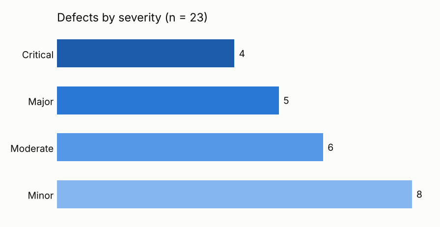
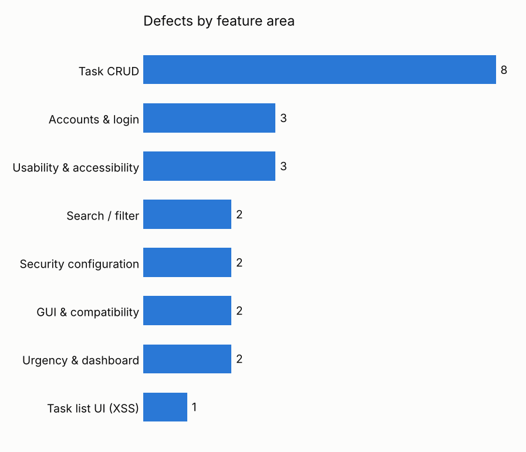

# PyTodo Pro – Final Integrated QA Evaluation Report

**Course:** TEB3433 Software Testing and Quality Assurance · **Team:** Alia (QA Lead), `<<M2>>`, `<<M3>>`, `<<M4>>` · **Date:** `<<submission date>>`

---

## 1. Executive summary

We evaluated PyTodo Pro, a Flask task manager with a web UI and REST API, over eight testing weeks. We ran **174 detection test executions** across black-box, white-box, GUI, usability/accessibility, API, security and performance testing, plus a **28-check automated regression suite**.

- **126 passed, 48 failed (pass rate 72.4 %)**. The failures trace to **23 distinct defects**: 4 Critical, 5 Major, 6 Moderate, 8 Minor. All remain open.
- **Overall verdict:** PyTodo Pro works for the common, well-formed single-user path. Registering, managing tasks, filtering and the dashboard all behave correctly for normal input, and performance is adequate for 20 concurrent users. It is **not fit for release to real users**: four Critical defects let one user read or delete another user's data (SQL injection, IDOR delete), run script in other users' browsers (stored XSS), or permanently break their own task list with one malformed date.
- **Main pattern:** the same rule is implemented in several places and only some copies are correct (UI vs API validation, GET vs DELETE ownership checks, UI vs API search). Plus three off-by-one boundary defects in the business rules.
- Testing reduces uncertainty but cannot prove the absence of defects. Section 10 lists residual risks and untested areas.

## 2. Application overview

See `01_Black_Box/Application_Overview.md` (Member 1). Summary: one user role. 12 functional requirements (REQ-01–12: accounts, task CRUD, filters, urgency, dashboard, API) and 5 non-functional (REQ-13–17: usability, accessibility, compatibility, security, performance). Business rules live in `helpers.py`. Data is in SQLite. Highest initial risks: access control and security (risk 9), then urgency, registration, login, task creation and the API (risk 6).

## 3. Test approach

Full plan: `07_Test_Management/Test_Plan.md`. Testing was risk-based. High-risk requirements were tested first and with at least two techniques. Expected results came from the specification (README, code "Spec:" comments, UI hints), never from observed behaviour. Each week's evidence fed back into the plan (see its revision history). For example, white-box findings in Week 2 raised the urgency risk, and Week 4 API crashes moved security to top priority in Week 5.

| Week | Activity | Main technique / tool | Key outcome |
|---|---|---|---|
| 1 | Black-box | EP, BVA, decision tables, state transition | 35 cases, 7 fail: password = 8, due today, duplicate user, blank title |
| 2 | White-box | Branch/path coverage, data flow (PyTest, pytest-cov) | 100 % branch coverage of `helpers.py`, 3 off-by-one defects |
| 3 | GUI, compatibility, usability, accessibility | Checklist, config matrix, heuristics, WCAG 2.1 | No mobile layout; missing labels; low contrast |
| 4 | Web + API | Valid/invalid/type/edge requests | 3 server crashes, weak validation on PUT/DELETE |
| 5 | Security + performance | STRIDE → tests; load steps 1–50 users | 3 Critical security defects; meets 20-user target |
| 6 | Automation + regression | PyTest markers, Selenium, strict xfail | 28 checks in ~7 s, stable over 3 runs |
| 7 | Test management | Test plan, RTM, defect log | 17/17 requirements traced |
| 8 | Metrics + evaluation | This report | – |

## 4. Results by phase

### 4.1 Black-box (Week 1)
35 executed · 28 Pass · 7 Fail. All 7 failures sit on a designed boundary or rule combination: password of exactly 8 chars (DEF-012), task due today (DEF-013, 4 cases), duplicate username (DEF-008), whitespace title on create/edit (DEF-014). Details: `01_Black_Box/`.

### 4.2 White-box and coverage (Week 2)
`helpers.py`: 31 executions, **100 % statement and branch coverage**, 3 failures, all off-by-one comparisons (DEF-012, DEF-013, DEF-015). The control-flow graph alone showed that "Due Today" is unreachable: 5 specified outcomes, only 4 return statements. Combined with the API, security and regression suites, `app.py` reaches 76 % branch coverage (79 % total). The uncovered code is mostly web-form routes tested at other levels, plus `__main__`.

### 4.3 GUI and compatibility (Week 3, Member 1)
18 GUI checks on Chrome desktop: 14 Pass, 4 Fail. Forms, navigation, messages, confirmation dialogs and keyboard order work well. **No viewport meta tag**, so phones show a shrunken desktop page (DEF-010). Dates and badges wrap awkwardly (DEF-011). 2 of 6 planned configurations were executed. Firefox, Edge and a real phone are listed as residual risk.

### 4.4 Usability and accessibility (Week 3)
Usability 4/8 pass: weak feedback (no success messages) and error recovery (forms cleared) → DEF-023; the misleading "Overdue" label. Accessibility 3/9 pass: labels not linked to inputs and an icon-only toggle (DEF-021); 2 contrast failures, 2.85:1 text and 1.54:1 borders (DEF-022); no reflow on mobile.

### 4.5 Web and API (Week 4)
47 executions · 33 Pass · 14 Fail. Happy paths, paging, filters and partial updates are correct. Three inputs crash the server with HTTP 500: integer title (DEF-016), invalid date (DEF-009), apostrophe in search (DEF-001). PUT and DELETE skip validation that POST performs (DEF-017, DEF-018, DEF-020). UI and API disagree on title rules (DEF-014).

### 4.6 Security (Week 5, Member 1)
12 STRIDE threats → 17 test cases (22 executions): 7 cases pass, 10 fail. Critical: SQL injection in API search (DEF-001), stored XSS (DEF-002), IDOR delete (DEF-003), invalid date breaking a user's list (DEF-009). Also: no CSRF (DEF-004), hard-coded secret + debug mode (DEF-005), duplicate usernames (DEF-008), no login throttling (DEF-006), no input length limit (DEF-007). Working controls: scrypt password hashing, HttpOnly session cookie, login required on every protected route, no username enumeration.

### 4.7 Performance (Week 5)
Load steps of 1–50 users on four endpoints, environment E1 (2 CPUs). **0 % errors at every level.** All endpoints meet the 20-user target (p95 < 1 s). Throughput plateaus beyond ~5 users. The task list degrades fastest (N+1 category queries). Login is the bottleneck: p95 2.3 s at 50 users, caused by deliberate scrypt cost. Results are trends on one machine, not production capacity.

### 4.8 Automation and regression (Week 6)
24 automated tests (28 executions) mapped to 40+ manual cases and 11 requirements. Known defects are encoded as strict xfail, so the suite is green today and will flag any fix or regression. 3 consecutive runs gave the same result: 20 pass, 8 xfail, 0 fail, ~7 s. Automation found no new defects; it guards against regressions rather than discovering them.

## 5. Metrics

Source: `07_Test_Management/Metrics.md` (generated from real execution results).

| Test level | Executed | Passed | Failed | Pass rate |
|---|---|---|---|---|
| Black-box | 35 | 28 | 7 | 80.0 % |
| White-box | 31 | 28 | 3 | 90.3 % |
| GUI | 18 | 14 | 4 | 77.8 % |
| Usability + accessibility | 17 | 7 | 10 | 41.2 % |
| API | 47 | 33 | 14 | 70.2 % |
| Security | 22 | 12 | 10 | 54.5 % |
| Performance | 4 | 4 | 0 | 100 % |
| **Total** | **174** | **126** | **48** | **72.4 %** |

Execution rate 100 % of planned test cases. 4 of 6 compatibility configurations not run. Regression: 20 pass, 8 known-defect xfail, 0 unexpected failures.

| Severity | High priority | Medium | Low | Total |
|---|---|---|---|---|
| Critical | 4 | 0 | 0 | 4 |
| Major | 3 | 2 | 0 | 5 |
| Moderate | 0 | 5 | 1 | 6 |
| Minor | 0 | 1 | 7 | 8 |
| **Total** | **7** | **8** | **8** | **23** |

**Interpretation (not just counts):**
- The **lowest pass rates** are in usability/accessibility (41 %) and security (55 %). These are the qualities the developer clearly did not test. Functional black-box and white-box rates are high (80–90 %), yet their few failures are concentrated on boundaries.
- **Task CRUD has the most defects (8)**. Most are API validation gaps of Moderate/Minor severity. **Security-related defects are fewer but carry all 4 Criticals.** Count alone would mislead: severity-weighted, security is the dominant risk.
- **Defect density ≈ 52 defects/KLOC** (23 / 0.44 KLOC of Python). Very high for so small an app, which points to missing developer-side testing and review.
- **Coverage vs defects:** 100 % branch coverage of `helpers.py` still hid three defects until the tests asserted spec-correct values. Coverage measures execution, not correctness.

## 6. Defect analysis

Full log: `07_Test_Management/Defect_Log.md`. Root-cause themes:

| Theme | Defects | Root cause |
|---|---|---|
| Duplicated logic, inconsistent copies | DEF-001, 003, 014, 017, 018 | Same rule implemented separately in UI and API routes; only some copies correct |
| Off-by-one boundaries | DEF-012, 013, 015 | Comparison operators (`>`/`>=`, `<=`/`<`) not checked against spec |
| Missing input validation | DEF-007, 009, 016, 019, 020 | Data trusted from client; no type/format/range checks |
| Unsafe output / config | DEF-002, 004, 005 | `|safe`, no CSRF library, secrets in source |
| Missing constraints | DEF-006, 008 | No DB UNIQUE constraint, no rate limiting |
| UI/accessibility not considered | DEF-010, 011, 021, 022, 023 | No responsive/WCAG review in development |

## 7. ISO/IEC 25010 mapping (Week 9)

| Characteristic | Sub-characteristics evaluated | How | Evidence quality |
|---|---|---|---|
| Functional suitability | Completeness, correctness, appropriateness | Black-box, white-box, API | **Direct, strong** |
| Security | Confidentiality, integrity, authenticity, accountability | STRIDE + security tests | **Direct** (accountability: review only) |
| Interaction capability (usability) | Learnability, operability, user error protection, UI aesthetics, inclusivity/accessibility | GUI checklist, heuristics, WCAG | **Direct, partial** (no real users, no screen reader) |
| Compatibility | Co-existence, interoperability (browsers) | Config matrix | **Partial** (2/6 configs) |
| Performance efficiency | Time behaviour, capacity | Load experiment | **Direct, limited** (one machine) |
| Reliability | Faultlessness, fault tolerance | Error handling found by API/security tests | **Indirect** |
| Maintainability | Testability, modularity | Unit-testability of `helpers.py`; duplicated logic seen in review | **Indirect** |
| Flexibility / portability | Installability | Install from README | Indirect only |

**Not adequately evaluated:** reliability over time (availability, recoverability, soak), portability (other OS/hosting), compatibility on Safari/real devices, accountability (no audit log to test), maintainability metrics (complexity/duplication measures across `app.py`).

## 8. CI/CD and continuous testing (Week 9)

The regression suite is designed for continuous testing. `.github/workflows/regression.yml` shows the pipeline:

1. **On every push / pull request:** install dependencies, then run `pytest -m "regression and not ui"`. Takes seconds and gates the merge.
2. **Nightly:** full suite including Selenium UI tests, security tests and the coverage report (artifact).
3. **Strict xfail** keeps the pipeline green while known defects are open, and turns red when a defect is fixed or a new failure appears. QA then retests and closes the defect.
4. **Coverage threshold** (`--cov-fail-under=75`) stops coverage from quietly dropping.
5. **Later stages (recommended):** dependency audit (`pip-audit`), static analysis (`bandit`, which would flag the f-string SQL and `debug=True`), and a Lighthouse accessibility check.

## 9. QA and process improvements (Agile/DevOps)

QA activities that would have **prevented** these defects:

| Improvement | Prevents | When in the workflow |
|---|---|---|
| Acceptance criteria with explicit boundary examples ("8 chars → accepted", "due today → Due Today") in each user story | DEF-012, 013, 015 | Backlog refinement |
| Developer unit tests with BVA before merge (TDD for `helpers.py`) | DEF-012, 013, 015 | Development |
| Single shared validation/service layer used by both UI and API | DEF-014, 017, 001, 003 | Design / code review |
| Peer code review checklist: parameterised SQL, owner scoping on every query, no `|safe`, secrets from env | DEF-001–005 | Pull request |
| Static analysis (bandit, flake8) in CI | DEF-001, 005 | CI |
| Security user stories from a STRIDE session per feature | DEF-003, 004, 006, 008 | Sprint planning |
| Definition of Done includes responsive + basic WCAG check | DEF-010, 011, 021, 022 | Sprint review |
| Automated regression suite in CI (section 8) | Reintroduction of all of the above | Continuous |

## 10. Residual risk assessment

| Risk ID | Residual risk | Source | L | I | Level | Mitigation |
|---|---|---|---|---|---|---|
| R-01 | Data of one user exposed or destroyed by another (SQLi, IDOR, XSS) | DEF-001, 002, 003 | 3 | 3 | **High** | Fix before any release; keep regression tests |
| R-02 | User's task list unusable after one bad API request | DEF-009 | 2 | 3 | **High** | Validate dates; DB repair script |
| R-03 | Session forgery / CSRF actions | DEF-004, 005 | 2 | 3 | **High** | Env secret, CSRF tokens |
| R-04 | Users confused or misled by urgency/dashboard | DEF-013, 015 | 3 | 2 | Medium | Fix comparisons |
| R-05 | Account confusion from duplicate usernames | DEF-008 | 2 | 2 | Medium | UNIQUE constraint |
| R-06 | Mobile and assistive-technology users excluded | DEF-010, 021, 022 | 3 | 2 | Medium | Responsive + WCAG fixes |
| R-07 | Unknown behaviour on Firefox/Edge/Safari/real phones | 4 configs not run | 2 | 2 | Medium | Run CFG-02–06 |
| R-08 | Behaviour under concurrent writes / long uptime unknown | Perf limitations | 2 | 2 | Medium | Locust mixed workload + soak test |
| R-09 | Unknown vulnerabilities in dependencies / deployment | Not tested | 1 | 3 | Low–Medium | `pip-audit`, deployment review |

**Important untested areas:** concurrent write load and SQLite locking; production deployment (HTTPS, headers, WSGI); real screen readers; Safari/iOS; data migration/backup; behaviour across timezones near midnight (urgency uses server date).

## 11. Prioritised recommendations

1. **(Critical, now)** Parameterise API search; remove `|safe`; scope DELETE by owner; validate due dates (DEF-001, 002, 003, 009).
2. **(High)** CSRF tokens + POST logout; secret from environment, debug off; UNIQUE usernames (DEF-004, 005, 008).
3. **(High)** Fix the three boundary operators in `helpers.py` and add a "Due Today" dashboard counter (DEF-012, 013, 015).
4. **(Medium)** One shared validation function for UI and API (title, types, category, paging) (DEF-014, 016–020, 007).
5. **(Medium)** Viewport tag, responsive table, labelled controls, contrast fixes, flash messages (DEF-010, 011, 021–023).
6. **(Process)** Adopt the CI pipeline in section 8 and the practices in section 9.
7. **(Future testing)** Run the remaining compatibility configurations; Locust mixed read/write + soak test; Lighthouse/axe + NVDA accessibility pass; retest all 23 defects once fixed.

## 12. Limitations

- The app was tested as delivered; no fixes were applied, so no defect could be retested or closed.
- Informal specification. Ambiguities (e.g. accented letters in usernames) were recorded as observations.
- Automated runs and performance figures come from one environment (E1). Other machines will give different absolute numbers.
- Compatibility limited to the browsers available to the team. Usability judged by the team, not by representative users.
- Security testing was controlled and minimal. It proves the weaknesses exist but does not measure their full extent.
- **Testing shows the presence of defects, not their absence.** A 72 % pass rate does not mean the remaining behaviour is defect-free.

## 13. Conclusion

PyTodo Pro is functionally solid on its main path but has serious, easily fixable weaknesses in security, input validation and boundary logic, and its accessibility is limited. The evidence chain for every finding runs requirement → risk → technique → test case → observed result → defect → residual risk → recommendation, and can be followed through the RTM and defect log. Fixing the four Critical defects and running the regression suite in CI would raise the product to an acceptable quality level for a first release.

## Appendices

A. Test Plan – `07_Test_Management/Test_Plan.md` · B. RTM – `07_Test_Management/RTM.md` · C. Master test repository – `07_Test_Management/Master_Test_Repository.md` · D. Defect log – `07_Test_Management/Defect_Log.md` · E. Metrics – `07_Test_Management/Metrics.md` · F. Coverage HTML – `02_White_Box_Coverage/coverage_html/index.html` · G. Performance data – `05_Security_Performance/Performance/`
